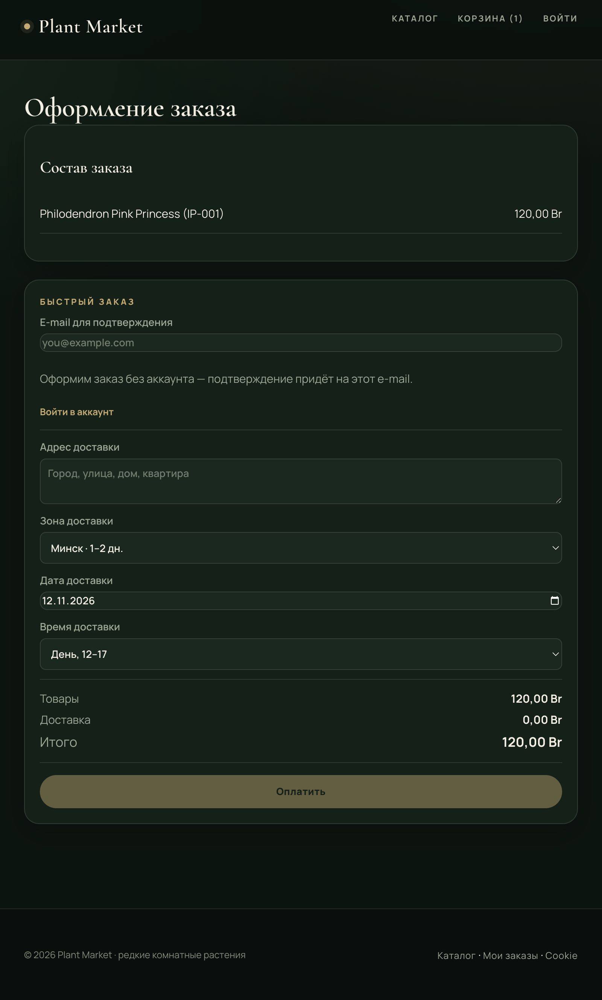
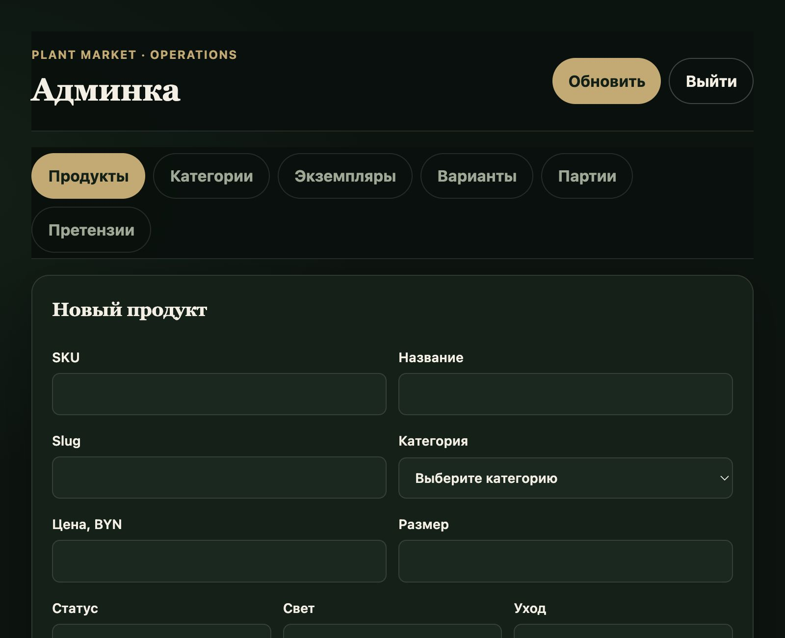
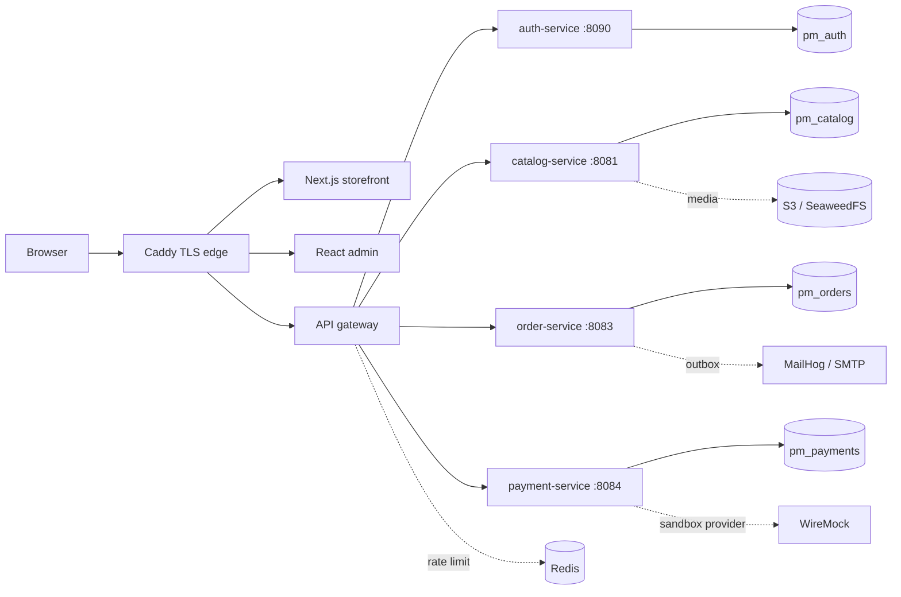

# Plant Market

**A production-shaped marketplace for rare houseplants where every listing is a specific, photographed plant — not a stock photo of "something similar".**

Plant Market is a full-stack portfolio project: five Spring Boot services, a Next.js storefront, a
React admin, OAuth2 PKCE, PostgreSQL per service, Redis rate limiting, S3 media, Docker secrets and
a TLS staging edge. The interesting part is not the CRUD — it is the money, stock and order
invariants around it.

[](https://openjdk.org/)
[](https://spring.io/projects/spring-boot)
[](https://www.postgresql.org/)
[](https://nextjs.org/)
[](#testing)
[](https://github.com/romaminsk/plant-market/actions/workflows/ci.yml)
[](https://github.com/romaminsk/plant-market/actions/workflows/security.yml)

## Screens

| Storefront | WYSIWYG plant page |
| --- | --- |
|  |  |

| Checkout with delivery window | Operations admin |
| --- | --- |
|  |  |

## What is WYSIWYG here

Each individual plant has its own code, price, gallery (general / leaf / roots / defects), care
level, light requirement and state machine:

`ACQUIRED → QUARANTINE → AVAILABLE → RESERVED → SOLD → DELIVERED` plus `RETURNED` and `MORTALITY`.

The storefront sells the exact plant shown. A variant (e.g. "12 cm pot") can also be sold from
stock batches, but the hero flow is the one-off plant.

## Architecture



- `auth-service` — users, roles, Argon2id, JWT access/refresh rotation, OAuth2 Authorization Server
  with PKCE, persistent JDBC authorizations.
- `catalog-service` — products, variants, individual plants, stock batches, media, reservations,
  restock subscriptions.
- `order-service` — order aggregate, checkout saga, claims, care reminders, shipping zones,
  delivery windows, outbox.
- `payment-service` — sandbox provider adapter, payment state machine, signed webhooks.
- `api-gateway` — single entry point, JWT authorization, CORS, Redis fixed-window rate limiting,
  request IDs.
- Storefront — App Router, server components + BFF route handlers, httpOnly cookies, PKCE.
- Admin — React/Vite SPA with cookie session, CSRF barrier and six operational tabs.

## Engineering highlights

- **Money correctness:** all amounts are integer minor units; prices are recomputed server-side;
  duplicate payment per order is blocked by a unique index.
- **Checkout saga:** reserve stock → `PENDING_PAYMENT` → provider payment → confirm stock. If
  confirmation fails after a charge, the order compensates with refund + release.
- **Order expiry:** a scheduled scanner cancels expired `PENDING_PAYMENT` orders, releases the
  reservation and records history/outbox. `/pay` after expiry returns `409 reservation-expired`
  without charging.
- **Webhook security:** HMAC-SHA256 over `timestamp + eventId + rawBody`, a 300-second timestamp
  window, event-id replay protection and an amount/currency check against the stored payment.
- **Outbox:** batches are claimed with `FOR UPDATE SKIP LOCKED`, leased via `next_attempt_at`, and
  notifications are sent outside the DB transaction. Retries back off to a dead-letter state.
- **Rate limiting:** Redis-backed fixed window shared across gateway instances; authenticated
  requests are bucketed by a validated principal, not by a spoofable `Bearer` header.
- **Media:** public `/media/**` contract with filesystem storage in dev and a private S3-compatible
  bucket in staging; catalog-service streams objects instead of exposing the bucket.
- **Staging:** Caddy TLS for app/admin/api subdomains, Docker secrets for JWT/DB/webhook, SeaweedFS
  S3, containerized frontends, backup/restore scripts and secure `__Host-` cookies.
- **API discipline:** RFC 7807 problems everywhere, UUIDv7 IDs, UTC timestamps, OpenAPI contracts,
  Conventional Commits and ADRs for every significant decision.

## Testing

| Layer | Count | What it proves |
| --- | ---: | --- |
| Backend unit/slice | 30 | UUIDv7, RFC 7807, pagination, rate limiting, webhook HMAC, secret policy |
| Integration (Testcontainers) | 51 | real PostgreSQL, Flyway, auth, catalog, orders, payments, gateway authz, outbox, TTL |
| E2E (Playwright) | 479 | storefront, admin, OAuth2 PKCE, checkout, delivery windows, claims, consent, a11y |
| Layout audit | 2 | no control overlap/overflow at 1280 and 390 |
| Mutation testing | 20/20 | PIT mutants killed |

The full E2E suite is deterministic: class order keeps seed-data assertions before the
350-scenario journey suite, and long-running admin journeys mint fresh access tokens.

## Run the demo

```bash
cp .env.example .env
./scripts/demo-up.sh
```

| Surface | URL |
| --- | --- |
| Storefront | http://localhost:3100 |
| Admin | http://localhost:5173 |
| API gateway | http://localhost:8080 |
| MailHog | http://localhost:8025 |
| WireMock | http://localhost:8089/__admin |

Demo users:

- customer: `customer@plantmarket.local` / `CustomerPassword123!`
- admin: `admin@plantmarket.local` / `AdminPassword123!`

Reset data:

```bash
DEMO_RESET_CONFIRM=yes ./scripts/demo-reset.sh
```

## Staging

The staging overlay adds TLS, Docker secrets, containerized frontends and S3 media:

```bash
./scripts/staging-init.sh
docker compose -f docker-compose.yml -f docker-compose.staging.yml \
  --env-file .env.staging up -d --build --wait
```

Runbook: [`docs/runbooks/staging.md`](docs/runbooks/staging.md). Backups:
`./scripts/staging-backup.sh`; restore with `RESTORE_CONFIRM=yes ./scripts/staging-restore.sh <dir>`.

## Repository map

```text
platform-common/     RFC 7807, request IDs, pagination, UUIDv7, secret policy
services/            gateway, auth, catalog, order, payment
contracts/           OpenAPI contracts
clients/             Next.js storefront, React admin
tests/e2e/           Playwright Java + Allure
infra/               Postgres, WireMock, staging Caddy/SeaweedFS
docs/                architecture, domain model, ADRs, runbooks, status
scripts/             dev/demo/staging/backup/test scripts
```

## Documentation

- [`docs/technical-guide.html`](docs/technical-guide.html) — deep technical walkthrough and project
  review in Russian.
- [`docs/architecture.md`](docs/architecture.md) — service boundaries and data ownership.
- [`docs/domain-model.md`](docs/domain-model.md) — aggregates, invariants and state machines.
- [`docs/status.md`](docs/status.md) — current state, test counts and known gaps.
- [`docs/adr/`](docs/adr/) — architecture decision records.
- [`docs/runbooks/`](docs/runbooks/) — operational scenarios.

## Status and limits

This is a portfolio/demo project, not a production shop yet:

- payments use a WireMock sandbox, not a real provider;
- legal/compliance work for Belarus (trade registry, ERIP, personal data, CITES, taxes) is not
  complete;
- the public staging DNS/ACME path, Vault/SOPS and a restore drill are documented but not exercised
  against real infrastructure;
- reviews and delivery-slot capacity are intentionally out of scope.

## License

No open-source license is granted. The code is published for portfolio review; contact the author
before reuse.
